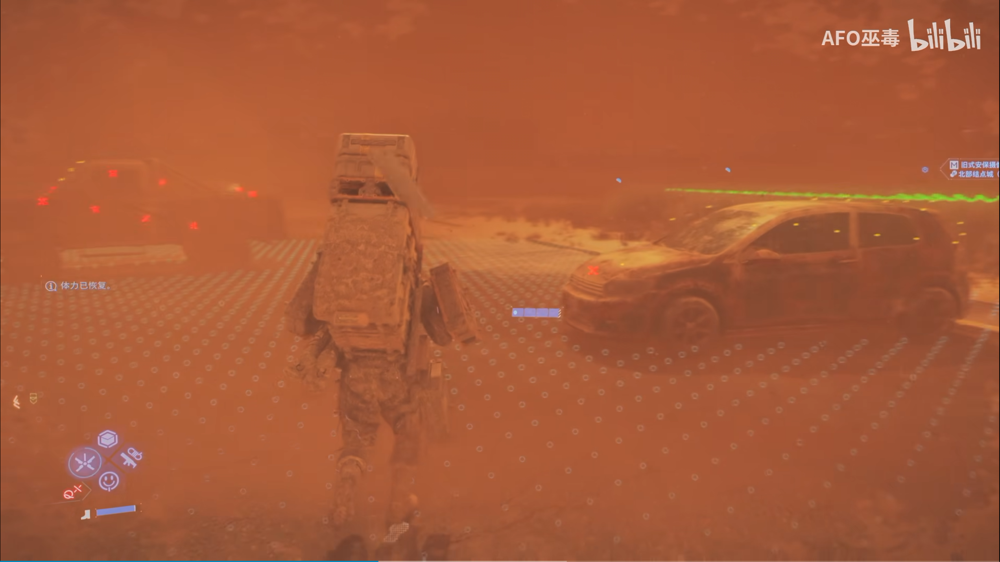
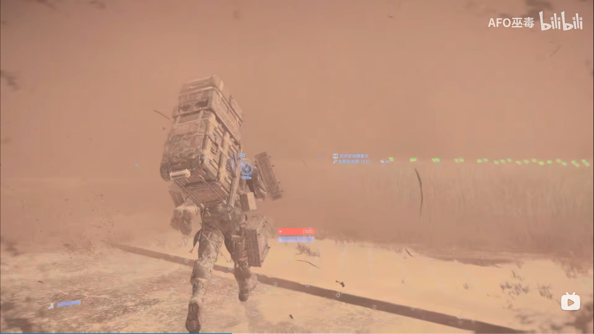

# 设计对象

本次环境声设计作业以《死亡搁浅2》中的沙尘暴场景为参考，为 Wwise 环境声工程制作持续的风沙底声与间歇出现的环境细节。场景以橙红色的风沙为主要视觉特征，道路两侧散布着废弃车辆，远处景物被沙尘遮蔽，沙尘暴中还会偶发闪电，整体呈现出荒凉、压抑且充满不安的氛围。设计以混合风沙声为基础，叠加短促的沙粒滑动声、金属抖动声和杂物被强风吹落地面的声音，并通过突发炸雷与绵延滚雷体现雷电天气的威胁感。



# 场景分析

该场景的声音重点是风沙持续包围的压迫感，以及强风作用于沙粒、金属部件和周围杂物时产生的变化。声音设计分为持续铺底的 Bed 与间歇出现的环境细节两个层次：前者建立整体风沙氛围，后者通过沙粒滑动、金属抖动、杂物落地与偶发雷鸣，表现环境中的不稳定因素，使持续的风沙背景具有疏密和强弱变化。

## 环境底声

Bed 以风声与沙粒的细密流动声为主体，持续建立沙尘暴的包围感。风声提供环境的规模与压迫感，沙粒声补充贴地掠过、被风卷动的颗粒质感，两者共同形成连贯的背景。

在此基础上融入轻微的金属部件碰撞与布料翻动声，表现置身强风中时，风对衣物和随身部件的扰动。这些细节在底声中保持较弱的存在感，与风沙融合，为较突出的环境变化留出听觉空间。

## 间歇性环境声

间歇性环境声用于表现风沙中的局部变化。沙粒滑动与金属抖动提供细碎、松散的动态，杂物落地表现狂风对周围物体的影响，雷声则带来更明显的强弱起伏。这些声音在持续底声中有疏有密地出现，保留自然的起音与消退过程。

| 声音元素 | 设计作用与听觉特征 |
| --- | --- |
| 沙粒滑动声 | 以短促、细密的摩擦与流动表现沙粒掠过表面的变化，在连续风沙中形成短时的颗粒起伏，并以自然淡出的方式融回背景。 |
| 金属抖动声 | 表现金属部件受风扰动时的松动、振动与细碎碰撞，以轻巧、不规则的响动增加环境的不稳定感。 |
| 杂物落地声 | 表现狂风将周围物件吹落地面时的接触与散落感，以短暂的落地动静体现风对物体的作用。 |
| 炸雷声 | 以突出的起音形成瞬间冲击，表现沙尘暴中偶发雷电的威胁感，与持续风沙形成动态上的变化。 |
| 滚雷声 | 以低沉、绵延且逐渐消退的雷鸣增加空间纵深，与炸雷的瞬间冲击形成长短和力度上的层次。 |

整体上，风沙 Bed 保持连续，沙粒、金属和杂物的声音补充局部细节，雷声承担较大的动态变化。各层声音需要保持主次关系，避免细节过密或持续突出，使风沙环境的压迫感与偶发变化都能得到体现。

# 声音素材获取与处理

本次使用的原始声音来自 Freesound、ZapSplat 及所选的在线视频素材，制作工作主要围绕素材筛选、片段截取与组合展开。根据场景需要，将原始录音转化为风沙环境底声、沙粒滑动、金属抖动、杂物落地、炸雷和滚雷六类成品，统一存放于 [Assets](../Assets/)，共 19 个 WAV 文件。

## 环境底声的组合与循环处理

`AMB_Desert_2D_Bed.wav` 由以下几类声音混合而成：

| 素材来源 | 在混合中的作用 | 已进行的处理 |
| --- | --- | --- |
| Proxima4 的 [Desert Simple.wav](https://freesound.org/people/Proxima4/sounds/104320/) | 提供风与沙粒的基础氛围，作为 Bed 的主体。 | 与其余细节素材叠加混合，并参与整体的循环修剪。 |
| [沙粒倾倒视频素材](https://www.youtube.com/watch?v=AVNJNsRdfdc) | 补充细密的颗粒感，使风沙环境中具有更具体的沙粒质感。 | 作为颗粒层加入 Bed 混合。 |
| ZapSplat 的 [Metal chain, swing, shake movements 2](https://www.zapsplat.com/music/metal-chain-swing-shake-movements-2/) 及同系列素材 | 借用链条轻响，表现强风中身上金属部件相互碰撞的感觉。 | 使用多个同系列片段，并通过 EQ 削减高频，减弱金属声的尖锐感，使其融入底声。 |
| Torikari 的 [Cloth/Sail Ruffle](https://freesound.org/people/Torikari/sounds/791964/) | 表现主角的衣物被风吹动的感觉，补充风沙中的布料翻动细节。 | 加入少量混响，再与其他声音混合。 |


上述声音在 Audition 中混合，并通过修剪确定可循环的片段，最终导出约 37.68 秒的 `AMB_Desert_2D_Bed.wav`。风沙构成持续背景，颗粒、金属和布料层共同补充身处沙尘暴中的感受。

## 沙粒滑动声的截取与包络处理

沙粒滑动声取自 ZapSplat 的 [Sand tip, slide on glass 1](https://www.zapsplat.com/music/sand-tip-slide-on-glass-1/)。原始录音表现沙粒在玻璃表面倾倒、滑动的声音，本设计借用其摩擦与流动质感，表现风沙中的短时颗粒变化。

从原素材中截取不同部分，整理为 `AMB_Desert_2D_Sand_Slide_1～4.wav` 四个片段。对片段设置音量包络，使声音逐渐淡出，避免沙粒声突然截断，让其收尾更自然。

## 炸雷与滚雷素材的整理

雷声根据听觉特征分为炸雷与滚雷两组。炸雷素材来自 Freesound 上 PNMCarrieRailfan 的 [Feli Ignite's Sound Effects Library Rains & Thunder](https://freesound.org/people/PNMCarrieRailfan/packs/38007/)，整理为 `AMB_Desert_2D_Thunder_Clap_1～3.wav`，用于表现较突出的雷声冲击。

滚雷素材来自 ZapSplat 的 [Thunder Sound Effects](https://www.zapsplat.com/sound-effect-packs/thunder-sound-effects/) 素材包，整理为 `AMB_Desert_2D_Thunder_Rumble_1～3.wav`。两组分别保存，便于在工程中区分突发的雷声起音与较长的滚雷变化。

## 金属抖动与杂物落地素材的选用

金属抖动声来自 ZapSplat 的 [Rattling Loose Metal](https://www.zapsplat.com/sound-effect-packs/rattling-loose-metal/) 素材包，整理为 `FOL_Metal_Rattle_1～4.wav`。利用这些短促的金属振动与碰撞，表现强风吹动松散金属部件时的环境细节。

杂物落地声来自 ZapSplat 的 [Leather Bag Drop & Set Down](https://www.zapsplat.com/sound-effect-packs/leather-bag-drop-and-set-down/) 素材包，整理为 `FOL_ToolBag_Drop_1～4.wav`。原始素材的录制方式是皮包落地，本设计取其物体接触地面及带动砂石的质感，用来表现狂风将周围物件吹落地面。素材的录制对象与最终表现对象有所不同，通过声音质感与场景需求的对应完成用途转换。

## 成品文件整理

经核对，Assets 文件夹中的 19 个音频均为 48 kHz、24 bit、双声道 PCM WAV，便于后续导入 Wwise。Bed 单独保存为循环底声，其余声音按类别及序号保存为独立片段，形成清晰的素材分组。

# Wwise 内的设计思路与配置方式

## 整体层次与容器组织

Wwise 工程采用“持续底声与随机细节叠加”的方式组织环境声。风沙 Bed 持续循环，维持沙尘暴的整体氛围；沙粒滑动、金属抖动和杂物落地以不同间隔出现，表现风对周围物体的扰动；雷声则由统一的雷电事件控制，在持续的风沙中形成较明显的动态变化。通过这种组合，使有限数量的素材在运行时产生不同的搭配，减少固定音轨反复播放的重复感。

整体使用 Blend Container `AMB_Desert_SandStorm` 同时播放各个声音层，主要结构如下：

```text
AMB_Desert_SandStorm（Blend Container）
├─ AMB_Desert_2D_Bed（循环底声）
├─ AMB_Desert_2D_Sand_Slide_Random（沙粒随机声）
├─ FOL_Metal_Rattle_Random（金属抖动随机声）
├─ FOL_ToolBag_Drop_Random（杂物落地随机声）
└─ AMB_Desert_Thunder_Loop（Sequence Container）
   └─ AMB_Desert_Thunder_Event（Blend Container）
      ├─ AMB_Desert_2D_Thunder_Rumble_Random（必播滚雷）
      └─ AMB_Desert_Thunder_Clap_Optional_Random（炸雷概率选择）
         ├─ AMB_Desert_2D_Thunder_Clap_Random
         └─ Silence_Thunder_Clap
```

## 间歇性声音的随机播放

沙粒、金属抖动和杂物落地分别放入 Random Container，使用 Standard Random 选择素材，开启 Continuous 与无限循环，并设置 Delay 作为片段之间的静默间隔。每次播放结束后等待一段随机时间，再选择下一个片段，使声音保持间歇性，避免连续堆叠。

| 声音层 | 首次播放延迟 | 片段结束后的随机静默 |
| --- | --- | --- |
| 沙粒滑动 | 6.5～10.5 秒 | 3～8 秒 |
| 金属抖动 | 3～6 秒 | 6～14 秒 |
| 杂物落地 | 5～9 秒 | 8～18 秒 |
| 雷电事件整体 | 15～25 秒 | 25～45 秒 |

首次延迟使不同声音层错开进入，随机静默则控制环境细节的疏密。沙粒出现相对频繁，构成风沙中的细小变化；金属与杂物声较为稀疏，突出偶发的物体扰动。素材选择设置为避免连续重复上一条，沙粒、金属和杂物还加入 ±2 dB 的音量随机与 ±50 cents 的音高随机，使同一录音多次出现时略有差异。雷声只加入 ±2 dB 音量随机，以保留其原有音色。

## 滚雷与炸雷的关联播放

雷声采用“每次都有滚雷，部分滚雷中出现炸雷”的设计。外层 `AMB_Desert_Thunder_Loop` 使用 Sequence Container，在播放列表中加入一次完整的 `AMB_Desert_Thunder_Event`，开启 Continuous 与无限循环。每次事件内的声音全部结束后，再等待 25～45 秒进入下一轮。

雷电事件内部使用 Blend Container 同时启动两条分支。第一条从三段 Rumble 中随机选择一段，使用 Step 模式单次播放，保证每次事件都有滚雷。第二条通过 Optional Random Container 决定是否加入 Clap：炸雷分支权重为 2，静默分支权重为 3，因此每次事件有 40% 的概率出现炸雷，60% 的概率只有滚雷。静默分支采用时长 0.1 秒的 Wwise Silence，不额外占用音频素材。

Optional 层使用 Standard Random，并关闭避免重复，使连续几次只有滚雷成为可能。实际播放 Rumble 或 Clap 时，其各自的素材选择仍避免相邻重复。炸雷分支进入前设置 1～4 秒的随机延迟，使其在滚雷已经开始后出现。该延迟短于最短滚雷的时长，保证炸雷开始时有滚雷伴随；炸雷尾音可以延续到滚雷结束之后，外层序列会等待两者均结束再进入静默间隔。

## 方位与距离的随机化

Bed 与 Rumble 保留宽阔的立体声环境感。沙粒、金属、杂物和 Clap 则通过 Positioning 表现不同方向和远近：开启 Override Parent 与 Listener Relative Routing，设置 3D Spatialization 为 Position、Pan/3D Mix 为 100%，并使用 Listener with Automation，使声源位置以听者为参照进行分布。相关衰减 ShareSet 的 Spread 设为 0，以保持局部声音的方向感。

Position Editor 采用单点路径与 Random Range，开启 Pick new path when sound starts。每次新声音开始时重新选择位置，单次播放期间保持位置稳定。随机范围在水平面展开，高度固定为 0，具体范围如下，单位为 Wwise 工程距离单位：

| 声音层 | 左右范围 | 前后范围 |
| --- | --- | --- |
| 沙粒滑动 | −8～8 | −8～8 |
| 金属抖动 | −12～12 | −12～12 |
| 杂物落地 | −16～16 | −16～16 |

Position Editor 中的坐标与 Random Range 按衰减最大距离的百分比换算。例如，沙粒的最大衰减距离为 30，左右与前后随机范围均约为 26.67%，对应实际位置在各轴上 −8～8 的变化。

炸雷设置前、后、左、右四个随机区域，先随机选择区域，再在区域内部随机位置：

| 区域 | 左右范围 | 前后范围 |
| --- | --- | --- |
| 前方 | −120～120 | 80～280 |
| 后方 | −120～120 | −280～−80 |
| 左方 | −280～−80 | −120～120 |
| 右方 | 80～280 | −120～120 |

这些区域避开听者身边，使炸雷保持一定距离，同时具有方位与远近变化。由于 Random Range 分别作用于坐标轴，其形成的是矩形区域，四个区域共同构成周围的分布，而非严格的环形随机。素材名称中的 `2D` 字样予以保留，实际空间表现由 Positioning 设置决定。

## 音量与 Low-pass 距离衰减

空间化声音同时使用音量与 Low-pass 距离衰减。音量下降表现声源远离，逐渐增加低通则削弱远处声音的高频细节，使远近差异不仅体现为响度变化，也体现为音色变化。沙粒、金属与杂物、炸雷分别使用以下 Attenuation ShareSet，控制点之间采用线性插值：

| Attenuation ShareSet | 距离控制点 | Volume 衰减（dB） | LPF 控制值 |
| --- | --- | --- | --- |
| `ATT_SandStorm_Sand` | 0、2、8、16、30 | 0、0、−6、−14、−40 | 0、0、8、15、25 |
| `ATT_SandStorm_Metal_Debris` | 0、2、8、16、30 | 0、0、−6、−14、−40 | 0、0、15、30、45 |
| `ATT_SandStorm_Thunder` | 0、50、150、300、600 | 0、0、−3、−7、−24 | 0、0、8、18、30 |

表中各组数值依次对应同一列的距离控制点。LPF 使用 Wwise 的 0～100 控制值，数值越大，低通作用越明显，并非直接填写截止频率。沙粒采用较轻的低通，保留细密颗粒；金属和杂物的高频随距离更明显地减弱。炸雷采用较缓的音量与低通衰减，在形成远距离感的同时，保留足够的起音与存在感。

沙粒容器保留已有的 Parametric EQ，对高频部分进行整形，再与距离低通共同作用；Bed 和 Rumble 不使用随机定位及距离衰减，维持整体环境的连续性与宽度。

## 混音平衡与播放控制

以持续的风沙为背景，各声音层的最终基础音量设置为：

| 声音层 | 基础 Voice Volume |
| --- | --- |
| Bed | 0 dB |
| 沙粒滑动 | −12 dB |
| 金属抖动 | −14 dB |
| 杂物落地 | −10 dB |
| Rumble | −2 dB |
| Clap | 0 dB |

这些值是工程中的相对增益，最终响度还受到原素材电平、子声音随机音量和距离衰减的影响。混音调整中提高了两层雷声的音量，并减轻远处炸雷的衰减，使其能够从风沙中显现，同时保留远近层次。

# 设计评价

本次设计围绕沙尘暴场景，建立了持续风沙、局部物体扰动与偶发雷声相互配合的环境声结构。随机选材、播放间隔和空间位置的变化，使有限素材能够形成较丰富的组合；滚雷必播、炸雷可选的关联方式，也让雷声具有一定的连续性与不确定性。通过音量和低通衰减区分远近，并在混音中调整雷声的存在感，基本实现了营造荒凉、压抑环境氛围的设计目标。

不足之处在于素材数量仍然有限，长时间播放时可能识别出重复片段；各类细节主要依靠随机间隔出现，与风势强弱的关联还不够充分。后续可补充更多质感相近的素材，并通过风力参数联动底声、沙粒和杂物声的音量与出现密度，使环境变化更有依据。
